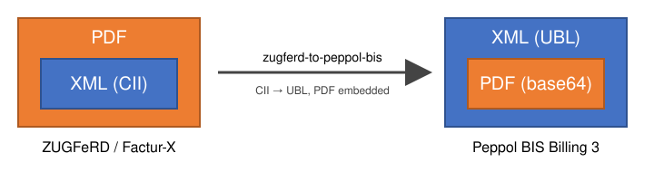

# zugferd-to-peppol-bis

<!-- ph-badge-start -->
[](https://maven-badges.sml.io/sonatype-central/com.helger.zugferd2peppol/zugferd-to-peppol-bis-parent-pom/)

> If this project saved you some time or made your day a little easier, a star would mean a lot — it helps others find it too.
<!-- ph-badge-end -->

Converts a valid **ZUGFeRD / Factur-X** hybrid invoice (PDF/A-3 with embedded CII XML) to a **Peppol BIS Billing 3** UBL invoice or credit note.
The original PDF is embedded as base64 into the UBL (BG-24 "Additional supporting documents", BT-125), so the XML is the one and only artefact to send via Peppol.



It glues together three existing projects:

| Step | Project | Purpose |
| ---- | ------- | ------- |
| 1 | [kaltblut](https://github.com/phax/kaltblut) | Detect flavor and profile, validate the PDF carrier rules (incl. PDF/A-3 via veraPDF) and extract the embedded XML |
| 2 | [en16931-cii2ubl](https://github.com/phax/en16931-cii2ubl) | Convert CII D16B to UBL 2.1 |
| 3 | [phive-rules-peppol](https://github.com/phax/phive-rules) | Validate the result against the Peppol BIS Billing 3 rules (XSD + Schematron) |

## Modules

Requires Java 17 and Maven.

| Module | Content |
| ------ | ------- |
| `zugferd-to-peppol-bis-lib` | The library (`com.helger.zugferd2peppol`) |
| `zugferd-to-peppol-bis-cli` | The command line client based on picocli; produces the fat JAR `zugferd-to-peppol-bis-cli-full.jar` |

```shell
mvn clean install
java -jar zugferd-to-peppol-bis-cli/target/zugferd-to-peppol-bis-cli-full.jar --help
```

## What happens

1. The PDF is validated with kaltblut (`HybridValidator`).
   Any finding with severity ERROR stops the processing.
2. The profile is checked.
   Rejected are `MINIMUM` and `BASIC WL` (no invoice lines, not EN 16931 compliant), as well as everything from ZUGFeRD 1.0 (`COMFORT`, different CII syntax).
   Converted are `BASIC`, `EN 16931`, `EXTENDED` and `XRECHNUNG`.
3. The embedded CII D16B XML is converted to UBL 2.1 (Invoice or Credit Note, decided by the converter).
4. The following values are set, independent of what the CII contained:
   * BT-24 CustomizationID: `urn:cen.eu:en16931:2017#compliant#urn:fdc:peppol.eu:2017:poacc:billing:3.0`
   * BT-23 ProfileID: `urn:fdc:peppol.eu:2017:poacc:billing:01:1.0`
5. The PDF is added as `cac:AdditionalDocumentReference` with `cbc:EmbeddedDocumentBinaryObject` (`mimeCode="application/pdf"`, `filename` = file name of the PDF; the same value is used as the reference ID).
6. Optionally the seller and buyer endpoint IDs and a fallback buyer reference are set, but only if the UBL does not contain them (see below).
7. The result is validated against the currently active Peppol BIS Billing 3 rules via phive.

### Data that ZUGFeRD does not contain

Peppol requires some information that ZUGFeRD simply does not carry.
The converter does not make up values - you need to provide them, otherwise the Peppol validation fails:

| Rule | Missing information | CLI option | Library setting |
| ---- | ------------------- | ---------- | --------------- |
| PEPPOL-EN16931-R020 | Seller electronic address (BT-34) | `--seller-endpoint scheme:id` | `setSellerEndpoint` |
| PEPPOL-EN16931-R010 | Buyer electronic address (BT-49) | `--buyer-endpoint scheme:id` | `setBuyerEndpoint` |
| PEPPOL-EN16931-R003 | Buyer reference (BT-10) or order reference (BT-13) | `--buyer-reference ref` | `setDefaultBuyerReference` |

Other problems of the source document (e.g. an invoice type code like `204` that Peppol does not allow, or missing payment means or seller contact for domestic German invoices) are reported by the Peppol validation and need to be fixed in the source.

## CLI

```shell
java -jar zugferd-to-peppol-bis-cli-full.jar \
     --seller-endpoint 0204:991-12345-67 \
     --buyer-endpoint 0204:991-76543-21 \
     --buyer-reference 04011000-12345-34 \
     -o out invoice1.pdf invoice2.pdf
```

For each `name.pdf` the file `name-ubl.xml` is written to the output directory (default: the directory of the PDF), but only if everything is valid.
The exit code is `0` if all files succeeded, otherwise `1`.

| Option | Meaning |
| ------ | ------- |
| `-o`, `--output-dir` | Output directory |
| `-c`, `--country` | Country specific kaltblut carrier rules (default `OTHER`) |
| `--no-pdfa` | Skip the PDF/A-3 validation |
| `--no-de-pdfa-downgrade` | Do not downgrade PDF/A findings for German invoices |
| `--seller-endpoint`, `--buyer-endpoint`, `--buyer-reference` | See above |
| `--no-peppol-validation` | Skip the Peppol validation of the result |
| `--force-output` | Write the UBL even if the Peppol validation reports errors |

## Library

```java
final ZugferdToPeppolSettings aSettings = new ZugferdToPeppolSettings ().setSellerEndpoint ("0204", "991-12345-67")
                                                                        .setBuyerEndpoint ("0204", "991-76543-21")
                                                                        .setDefaultBuyerReference ("04011000-12345-34");
final ZugferdToPeppolResult aResult = new ZugferdToPeppolConverter (aSettings).convert (HybridSource.fromFile (new File ("invoice.pdf")));
if (aResult.isSuccess ())
  Files.write (Path.of ("invoice-ubl.xml"), aResult.getUBLXML ());
else
{
  // aResult.getHybridResult ()      - kaltblut findings
  // aResult.getRejectionReason ()   - unsupported profile etc.
  // aResult.getConversionErrors ()  - CII to UBL problems
  // aResult.getPeppolResult ()      - Peppol BIS Billing validation
}
```

The library depends on `kaltblut-core` only, which has no PDF/A-3 validator built in.
Add `com.helger.kaltblut:kaltblut-verapdf` to your classpath to get the PDF/A-3 check; otherwise kaltblut only records an INFORMATION finding.
The CLI already includes it.

## Limitations

* Only CII D16B (EN 16931:2017) is supported, because that is what all ZUGFeRD 2.x / Factur-X versions use and what Peppol BIS Billing 3 is based on.
* Only the XML is validated against the business rules; the PDF content itself is not compared with the XML.
* The PDF is embedded as-is. Mind the size limits of your Peppol Access Point.

# News and noteworthy

v1.0.0 - 2026-11-04
* Initial version
  Contains a library and a command line client

# My courtesy

[](https://www.paypal.me/philiphelger)

---

My personal [Coding Styleguide](https://github.com/phax/meta/blob/master/CodingStyleguide.md) | It is appreciated if you star the GitHub project if you like it.
